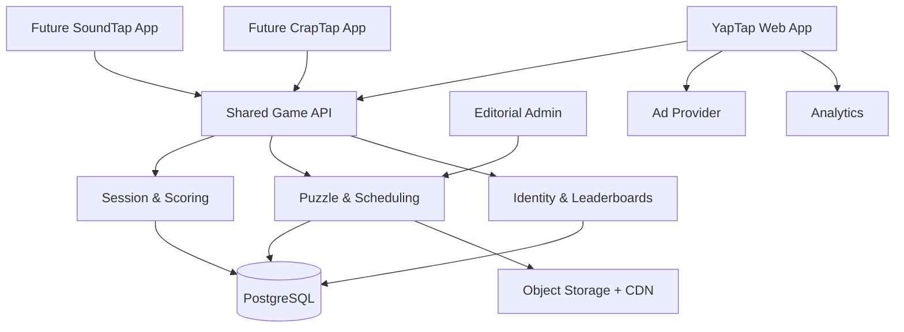

# YapTap — Product Requirements Document

> Source: ChatGPT session, 2026-10-17, cleaned up from its UI markup. Reference only: where this disagrees with `../plan.md` or `../decisions.md`, those win (stack is Vite SPA on Render, audio is FLEURS, scoring is the "recommended correction" in section 3).

Version 1.0 · October 17, 2026 · MVP specification

**YapTap** is a free, daily audio-geography game. Players listen to a short recording of someone speaking and attempt to identify where the speaker is from by placing guesses on a world map.

The game combines linguistic recognition, geographic knowledge, and deduction. Players receive progressively more informative feedback, with higher scores awarded for accurate early guesses.

YapTap will launch as a standalone website within a network of daily guessing games, sharing accounts, infrastructure, advertising, and analytics with future products such as SoundTap and CrapTap.

At a glance: audio-first (8–15s clips), geographic (5 guesses max), daily-only (one puzzle per day).

## 1. Product definition

### Core decisions

| Dimension | Specification |
|---|---|
| Primary platform | Mobile-first responsive web |
| Session duration | 45–120 seconds |
| Daily content | One recording, identical for all players |
| Daily reset | 00:00 UTC |
| Guesses | Maximum 5 |
| Input | Select a country on an interactive map |
| Feedback | Distance, direction, and language-family clue |
| Scoring | 0–5,000 points |
| Account requirement | None to play |
| Monetization | Display advertising; no subscriptions |
| Languages | English UI initially, multilingual speech content |
| Network | Independent domain, shared identity and backend |

### Core game premise

**"Hear the world. Guess where."**

Every day, a speaker says a short phrase in a language that the player may or may not recognize.

The player's task is to locate the recording's geographic origin, not merely identify the language.

For example, hearing Spanish doesn't automatically identify the answer: the speaker could be from Colombia, Mexico, Spain, or Argentina.

Each puzzle has a specific verified geographic target.

### Explicit non-goals for MVP

- No unlimited practice mode.
- No multiplayer matches or live competition.
- No native iOS or Android applications.
- No subscription or in-app purchases.
- No speech transcription or AI-assisted hint generation during gameplay.
- No user-uploaded recordings.
- No precise identification of a speaker's home or personal location.

## 2. Exact gameplay rules

Round lifecycle

**Listen**

The player receives a single 8–15-second recording. Playback can be repeated without penalty.

**Choose a location**

Tap a country on the world map. A confirmation button prevents accidental submissions.

**Receive feedback**

Show distance to the target, compass direction, and an increasingly informative linguistic hint.

**Try again**

Continue for up to five total guesses. Previously selected countries remain visible.

**Reveal and compare**

Show the correct country, language, contextual information, score, and daily performance statistics.

### Guess validation

- Each guess must be a selectable country or territory supported by the map dataset.
- The same location cannot be submitted twice.
- There is no timer, and replaying audio does not reduce the score.
- A correct country ends the round immediately.
- After five incorrect guesses, the round ends with the answer revealed.
- Closing the browser preserves submitted guesses and remaining attempts.
- One completed round is permitted per account per day. Anonymous play is supported, but cross-device enforcement requires identity.

### Geographic target

For MVP, each puzzle is tagged with one **country-level origin**, backed by a source that supports the recording's geographic attribution.

This is important because a language can be spoken across many countries. We are not attempting to infer the speaker's birthplace from their voice; the puzzle's origin is editorially verified.

A later version can support region- and city-level puzzles.

## 3. Scoring algorithm

The scoring system should reward both proximity and identifying the correct country quickly.

### Distance calculation

For each guessed country, use a curated representative geographic coordinate, such as an appropriate country centroid. Calculate great-circle distance to the target country's representative coordinate using the Haversine formula.

$$d=2R\arcsin\left(\sqrt{\sin^2(\Delta\phi/2)+\cos(\phi_1)\cos(\phi_2)\sin^2(\Delta\lambda/2)}\right)$$

Where $R=6371.0088$ km.

These distances represent distances between country reference points, not the shortest distance between their borders.

### Points per guess

Use an exponentially decaying distance score:

$$P(d)=\operatorname{round}(1000e^{-d/2000})$$

An exact country match receives 1,000 points regardless of centroid distance.

| Distance | Approximate points |
|---|---:|
| Correct country | 1,000 |
| 500 km | 779 |
| 1,000 km | 607 |
| 2,000 km | 368 |
| 5,000 km | 82 |
| 10,000 km | 7 |

### Final score

For MVP, each guess contributes its proximity points to the total:

$$S=\sum_{i=1}^{n}P(d_i)$$

Maximum theoretical score: 5,000.

However, a correct guess immediately ends the round, so the maximum achievable score under these rules would be 1,000. That makes the advertised 5,000-point scale inconsistent.

**Recommended correction:** score only the best guess and apply an attempt multiplier:

$$S=\operatorname{round}\left(5000e^{-d_{\min}/2000}m(n)\right)$$

Where $d_{\min}$ is the smallest distance among submitted guesses, and:

| Guesses used | Multiplier |
|---|---:|
| 1 | 1.00 |
| 2 | 0.85 |
| 3 | 0.70 |
| 4 | 0.55 |
| 5 | 0.40 |

This produces a 5,000-point maximum for a correct first guess and 2,000 points for a correct fifth guess.

An unsuccessful player can still earn points based on their nearest guess.

For a completed round, use the final attempt count, even if the nearest guess was submitted earlier.

### Scoring edge cases

A correct first guess always beats any result requiring more attempts. However, under the proposed formula, a very close incorrect first guess could beat an exact second guess. That is acceptable only if the product deliberately rewards proximity over exact identification.

For YapTap, I recommend **prioritizing exact identification**. Use two ranking fields:

1. `solved`: whether the correct country was identified.
2. `score`: distance-adjusted score within solved or unsolved groups.

Leaderboards sort solved players above unsolved players, then by score. Ties share a rank.

## 4. Content and puzzle schema

Each recording needs verified origin metadata, licensing information, and enough information to provide progressive hints.

**DailyPuzzle**
```json
{
"id": "yaptap-2026-10-17",
"game": "yaptap",
"publish_date": "2026-10-17",
"status": "scheduled",
"audio": {
  "asset_id": "audio_000183",
  "duration_ms": 11750,
  "format": "audio/webm",
  "loudness_lufs": -16
},
"answer": {
  "country_code": "GE",
  "language_code": "kat",
  "language_name": "Georgian",
  "dialect": null,
  "origin_verified": true
},
"hints": [
  {
    "after_guess": 1,
    "text": "This language has its own writing system."
  },
  {
    "after_guess": 2,
    "text": "It belongs to the Kartvelian family."
  },
  {
    "after_guess": 3,
    "text": "It is spoken in the Caucasus."
  },
  {
    "after_guess": 4,
    "text": "Its name begins with G."
  }
],
"source": {
  "provider": "licensed_recording",
  "license_id": "lic_000183",
  "consent_verified": true
}
}
```
Example schema. Georgian is illustrative, not a confirmed scheduled recording.

### Additional database entities

| Entity | Essential fields |
|---|---|
| `AudioAsset` | ID, storage key, checksum, duration, source, license, consent, attribution |
| `DailyPuzzle` | ID, date, asset ID, answer, hints, status |
| `Player` | ID, optional account ID, created timestamp |
| `GameSession` | Player, puzzle, state, started/completed timestamps, score |
| `Guess` | Session, attempt number, country, distance, points, timestamp |
| `DailyStats` | Puzzle, players, solve rate, score distribution |
| `NetworkIdentity` | Shared account ID, provider, preferences |
| `AdEvent` | Placement, game, session, impression, consent state |

Use ISO 3166-1 alpha-2 country codes where applicable, with a separate canonical location identifier for territories and disputed or nonstandard regions.

Use ISO 639-3 language codes to distinguish languages that cannot be represented accurately with two-letter codes.

### Content sourcing and quality control

The editorial pipeline should be:

Acquire licensed recording

Verify language and geographic attribution

Normalize audio and remove identifying metadata

Generate and review progressive hints

Editorial approval and scheduled publication

The MVP should launch with at least **45 approved recordings**, allowing a 30-day publishing runway and a buffer for rejected or withdrawn content.

Content selection should balance geographic regions, language families, difficulty, and recording quality. Avoid consecutive puzzles with the same answer country or language.

## 5. UX specification

The interface should be deliberately minimal: audio player, interactive world map, guess history, and results. No navigation-heavy experience.

### Screen A — Daily challenge

yaptap.
Daily language geography game

7

DAILY #001
Where is this person speaking from?

0:12

**Select a country**
Guess 1 of 5

Tap the map or search a country

Submit guess

Illustrative screen composition, not a functional audio or map prototype.

### Screen B — Guess feedback

After submitting a guess, the UI transitions to a feedback state without navigating away.

**Guess 1: Turkey**
Not quite

Distance
~1,300 km

Direction
NE

Guesses left
4

**Linguistic clue**

This language has its own writing system.

Example feedback for a Georgian-origin puzzle. Distance is illustrative and depends on the chosen reference coordinates.

The map should display the submitted country, a direction arrow, and a proximity indication. Previously submitted guesses remain visible as numbered markers.

### Screen C — Final results

You found it!
Georgian · Georgia
3,500
Points · Solved in 3 guesses

**About today's language**

Georgian belongs to the Kartvelian language family and uses its own distinctive script.

Your percentile
Top 18%

Daily streak
7 days

Share result
Mock result values. Actual percentiles require sufficient completed-player data.

### Additional screens

| Screen | Requirements |
|---|---|
| Welcome | Explain the premise and start the daily game immediately |
| How to play | Short interactive explanation, without consuming today's attempt |
| Leaderboard | Daily score ranking, solve status, anonymous display names |
| Profile | Streak, games played, average score, solve rate |
| Archive | Previous results only; no replaying past puzzles |
| Settings | Audio volume, accessibility, consent and privacy controls |
| Network hub | Links to other games, without disrupting today's YapTap session |

### Mobile interaction details

The map is the largest UX risk. A full world map with small countries is difficult to operate on a phone.

The MVP must therefore support both map tapping and searchable country selection. Selecting from search should focus and highlight the corresponding country on the map.

Use MapLibre GL JS with a country-boundary layer or a lightweight SVG/vector map if performance and implementation simplicity are better. MapLibre is not strictly necessary for a country-level game.

Accessibility requirements include keyboard-accessible country search, sufficient contrast, reduced-motion support, screen-reader labels, and a visible volume control.

The recording should not be replaced with a transcript during the active round because transcription would disclose much of the answer. Provide an equivalent accessible alternative where feasible, with clear communication about the game's audio-dependent nature.

## 6. Anti-cheating and game integrity

This is especially important if YapTap eventually has a public leaderboard.

There is a fundamental limitation: **players can record the audio and use external speech-recognition or language-identification tools**. That cannot be completely prevented in a public browser game.

The objective should be to prevent trivial technical exploits and make automated cheating less useful, not to claim cheating is impossible.

### Threat model

| Attack | Mitigation | Priority |
|---|---|---|
| Inspect API response for answer | Never send answer metadata before completion | Critical |
| Submit unlimited guesses | Server-authoritative attempt counter | Critical |
| Replay session to reset attempts | Persistent session per player and puzzle | Critical |
| Submit guesses concurrently | Transactional updates and unique attempt constraints | Critical |
| Submit a forged score | Compute score exclusively on server | Critical |
| Create many anonymous identities | Rate limits, device/session heuristics, leaderboard eligibility rules | High |
| Inspect public audio filename | Opaque asset identifiers without language/country information | High |
| Use speech-recognition AI | Accept as residual risk; monitor anomalous results | Medium |
| Scrape future puzzle assets | Publish media only when puzzle becomes active | High |
| Manipulate streaks | Server-side UTC date calculations | High |

### Server-authoritative submission

Every guess is handled by a transaction:

1. Authenticate the session or anonymous player token.
2. Load the active daily puzzle and session.
3. Verify that the round is active and fewer than five guesses have been submitted.
4. Validate the selected location.
5. Reject duplicate guesses.
6. Calculate geographic distance and determine correctness.
7. Persist the guess and update the session atomically.
8. Return only permitted feedback and unlocked hints.
9. Reveal the answer when the round is completed.

Use an idempotency key per submission to ensure retries cannot consume additional attempts.

### Identity and leaderboard integrity

Anonymous players can complete the daily puzzle without registration.

However, I'd require a verified account to enter the competitive global leaderboard. Anonymous players still receive scores, streaks on their device, and aggregate comparison statistics.

This reduces—but does not eliminate—multi-account manipulation.

For the MVP, I'd avoid financial prizes or rewards based on leaderboard placement.

## 7. Technical architecture

The system should be built as a **multi-game platform with game-specific frontends and shared backend services**.



### Recommended stack

| Layer | Technology | Rationale |
|---|---|---|
| Frontend | Next.js, TypeScript | Responsive web, routing, SEO |
| Map | MapLibre GL JS or SVG map | Interactive country selection |
| Backend | FastAPI, Python | Clear scoring and content-processing APIs |
| Database | PostgreSQL | Sessions, puzzles, submissions, rankings |
| Cache | Redis, optional | Leaderboard and rate-limit optimization |
| Audio storage | Cloudflare R2 or S3 | Private source assets, controlled publication |
| CDN | Cloudflare | Low-latency global audio delivery |
| Authentication | Shared OIDC-compatible provider | One identity across all games |
| Hosting | Cloud Run or equivalent | Simple deployment and autoscaling |
| Analytics | PostHog or equivalent | Product funnels and retention |
| Ads | Google AdSense initially | Web display advertising |
| Monitoring | Sentry + structured logs | Errors and latency |

Redis can be deferred until actual traffic warrants it. PostgreSQL is sufficient for an MVP.

### Monorepo structure

```text
daily-games/
├── apps/
│   ├── yaptap-web/
│   └── admin/
├── services/
│   └── game-api/
│       ├── games/
│       │   └── yaptap/
│       ├── sessions/
│       ├── identity/
│       ├── leaderboards/
│       └── content/
├── packages/
│   ├── game-client/
│   ├── ui/
│   ├── analytics/
│   └── ad-components/
├── data/
│   ├── country-boundaries/
│   └── country-reference-points/
└── infrastructure/
```

The shared platform should not force every game to use the same scoring algorithm. Each game implements a scoring contract, while the shared service owns sessions, validation, persistence, and leaderboard aggregation.

### API contract

| Endpoint | Method | Purpose |
|---|---|---|
| `/v1/games/yaptap/today` | GET | Public puzzle metadata and media URL |
| `/v1/games/yaptap/session` | POST | Start or resume today's session |
| `/v1/games/yaptap/guess` | POST | Submit country and receive feedback |
| `/v1/games/yaptap/result` | GET | Completed result or active-session state |
| `/v1/games/yaptap/leaderboard` | GET | Ranked completed sessions |
| `/v1/games/yaptap/stats` | GET | Aggregate daily statistics |
| `/v1/me/games` | GET | Cross-game profile and progress |
| `/v1/admin/puzzles` | POST | Create and schedule editorial content |

### Example guess request

```json
{
"session_id": "sess_83fa",
"country_code": "TR",
"idempotency_key": "guess-1-83fa"
}
```

### Example response

```json
{
"attempt": 1,
"correct": false,
"distance_km": 1300,
"bearing_degrees": 45,
"remaining_guesses": 4,
"hint": "This language has its own writing system.",
"completed": false
}
```

The API must not expose answer coordinates, language metadata, future hints, or correct-country codes until the session ends.

### Cross-game account architecture

Each game has its own domain and branding. The shared identity provider handles authentication through a central identity domain.

A player who signs in on YapTap can use the same credentials on SoundTap, although browser restrictions on cross-domain cookies mean each app should establish its own authenticated session through a standard redirect-based OAuth/OIDC flow.

Network-level data can aggregate streaks, achievements, and engagement across games.

## 8. Advertising and monetization

YapTap is free. There are no subscriptions, paid hints, or rewarded advertisements that affect gameplay.

The business model depends on retaining users who return daily and generating a small number of valuable ad impressions per session.

### Ad placements

**Results-screen display ad**

Primary placement. Appears after the puzzle has ended, near the results and share controls. Does not block the answer.

**Secondary ad beneath daily statistics**

Optional additional impression for players scrolling through results, rankings, and network recommendations.

**Direct sponsorship**

Future opportunity to sponsor the daily challenge or results page. Sponsorship must be clearly labeled and editorially separate from the answer.

I would **not put interstitials between guesses**. The entire session is only about a minute long, and interrupting it would damage the core experience.

### Advertising revenue model

For planning purposes, assume 1.5 monetized impressions per daily active user and a blended $3 display eCPM.

Illustrative annual gross ad revenue, assuming 30-day months and constant DAU

| Daily active users | Monthly impressions | Annual ad revenue |
|---|---:|---:|
| 1,000 | 45,000 | $1,620 |
| 10,000 | 450,000 | $16,200 |
| 50,000 | 2,250,000 | $81,000 |
| 100,000 | 4,500,000 | $162,000 |
| 250,000 | 11,250,000 | $405,000 |

Actual yield will vary by country, fill rate, ad visibility, consent, seasonality, and advertiser demand. The $3 figure is an assumption, not a verified YapTap rate.

### Advertising compliance

Implement a consent management platform appropriate for the jurisdictions served. Respect applicable privacy requirements and the ad provider's consent rules.

Ads should not target users using inferred ethnicity or nationality based on the languages they hear or their guesses.

## 9. Analytics and success criteria

The product should instrument the complete daily funnel.

| Metric | Definition | Initial target |
|---|---|---|
| Start rate | Visitors who begin today's puzzle | ≥70% |
| Completion rate | Started sessions that reach a final result | ≥80% |
| D1 retention | Players returning the following day | ≥25% |
| D7 retention | Players returning seven days later | ≥12% |
| Share rate | Completed sessions invoking the share action | ≥8% |
| Audio playback success | Sessions where audio plays successfully | ≥99% |
| API latency p95 | Guess submission processing | Under 300 ms, excluding network |
| Ad impressions/session | Monetized impressions per completed session | 1–2 |

These are initial product hypotheses, not industry benchmarks.

Track completion and retention by device, acquisition source, puzzle difficulty, language family, and region.

Also track per-puzzle solve rate and median number of guesses. This will help identify content that is too obvious or nearly impossible.

For leaderboards, calculate daily percentiles only among completed sessions and label the population clearly.

## 10. Development milestones

Assuming one experienced full-stack engineer, I would target a **six-week MVP**, with content acquisition running in parallel.

PROPOSED IMPLEMENTATION SCHEDULE
| Week | Focus | Scope |
|---|---|---|
| Week 1 | Playable game | Audio player, country map, guess input, basic scoring |
| Week 2 | Backend and persistence | Daily puzzles, sessions, scoring API, PostgreSQL |
| Week 3 | Feedback and results | Hints, map feedback, score display, sharing, streaks |
| Week 4 | Content administration | Audio processing, editorial review, puzzle scheduling |
| Week 5 | Monetization and analytics | Ads, consent, tracking, identity, leaderboard |
| Week 6 | QA and launch | Mobile testing, security, accessibility, content verification |

### MVP acceptance criteria

- [ ] Daily puzzle loads consistently on mobile and desktop
- [ ] Audio can be replayed without penalty
- [ ] Country selection works via map and search
- [ ] Server enforces exactly five maximum guesses
- [ ] Score, distance, bearing, and hints are calculated correctly
- [ ] Refresh and browser restart preserve the session
- [ ] Correct answers are hidden until round completion
- [ ] Completed results include answer, score, and shareable summary
- [ ] 45 licensed, reviewed recordings are ready
- [ ] Ads and consent controls work without interrupting gameplay
- [ ] Anonymous play and verified leaderboard accounts work
- [ ] Monitoring, backups, and deployment rollback are configured

## 11. Estimated implementation effort

| Workstream | Engineering hours |
|---|---:|
| Core UI and map | 25–40 |
| API, scoring, sessions | 25–40 |
| Content management | 15–25 |
| Accounts and leaderboards | 15–25 |
| Ads and analytics | 10–20 |
| QA, deployment, security | 20–30 |
| **Total** | **110–180** |

The estimate assumes you are doing the engineering and excludes the time required to source and review recordings. Six weeks is feasible at roughly 20–30 focused engineering hours per week, with some contingency.

## 12. Design decisions I would lock before coding

Three refinements would make the specification stronger.

**First: use a strict, deterministic scoring rule.** The current distance-weighted formula is workable, but it should be finalized with a test suite proving that exact solves rank ahead of all misses, scores decline with distance for a fixed attempt count, and earlier correct guesses rank higher than later correct guesses. I would use a separate solved/unsolved ranking category rather than relying solely on the numeric score.

**Second: distinguish country origin from language identity.** The puzzle answer should always be an editorially verified country of origin. A language spoken in several countries is perfectly valid, provided the recording's origin is independently documented. Don't rely on AI accent detection to assign the answer.

**Third: optimize for repeat visits, not session duration.** A daily-only game is unlikely to generate many impressions per visit. The most valuable behavior is a player returning tomorrow and discovering another game in the network.

### Recommended launch sequence

Launch YapTap with 45 recordings, five guesses per day, geographic feedback, progressive hints, and a shareable results screen.

Once it has enough usage to evaluate retention, add the network hub and introduce SoundTap as the second game. That creates a natural distribution loop between two audio-based products while keeping their mechanics distinct.

**The primary launch question isn't whether YapTap can technically be built. It's whether users enjoy identifying a language's geographic origin enough to return every day.** A small playable prototype with 10 carefully selected recordings should answer that before investing heavily in the full platform.

---

If you want, I can:

- Summarize this conversation
- Develop a phased MVP development plan
- Create a concise product feature checklist
